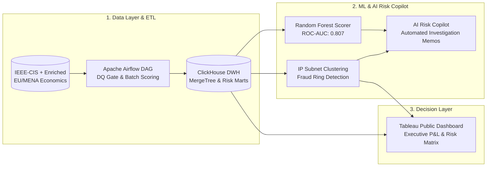
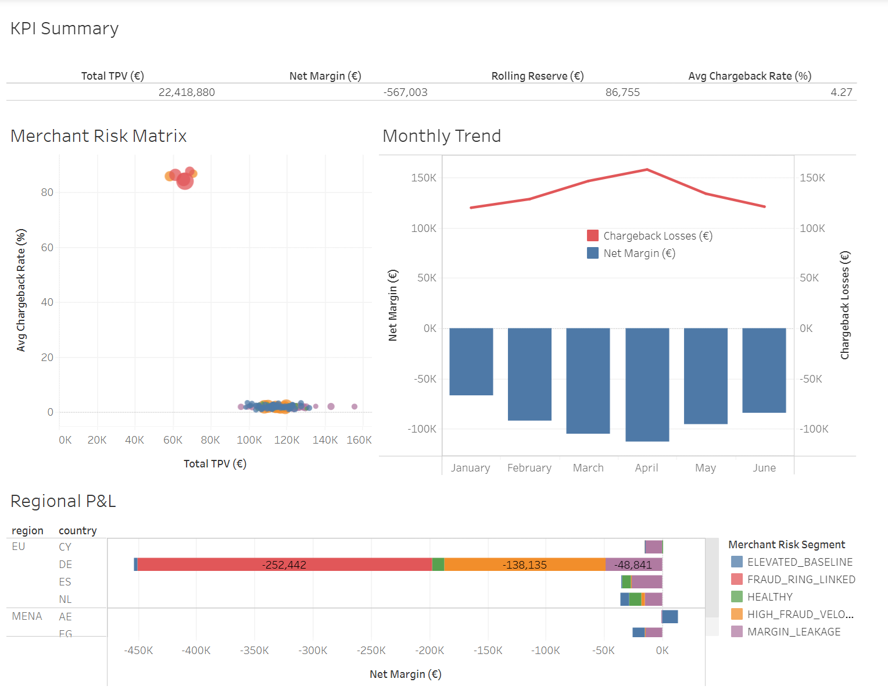

# 🛡️ FinGuard: End-to-End Payment Risk & Margin Intelligence Platform

[](https://www.python.org/)
[](https://://clickhouse.com)
[](https://airflow.apache.org/)
[](https://://tableau.com)

> **Executive Summary:** An end-to-end payment risk, fraud clustering, and margin protection framework designed for high-volume multi-region acquiring ecosystems (**EU & MENA**). Built to mirror production architectures handling 50M+ monthly transactions without exposing proprietary NDA data.

---

## 🎯 Business Problem & Impact

In high-growth payment gateways operating across regulated (**EU**) and cross-border (**MENA**) markets, unmonitored merchant risk and static pricing create severe P&L leakage:
* **Hidden Fraud Rings:** Coordinated merchant networks rotate legal entities while sharing underlying `/24` IP subnets.
* **Chargeback Velocity Spikes:** High-risk MCCs (Travel, Digital Goods) generate sudden dispute surges before static payout holds react.
* **Margin Leakage:** Aggressive sales discounting (`contract_fee < interchange + gateway_cost`) results in negative net margin on corporate/credit card volume.

### Simulated Portfolio Results (180K Transactions | €22.42M Gross TPV)
* **Uncovered €567.0K Net Margin Deficit** driven by 3 distinct anomaly vectors across 200 merchants.
* **Detected 100% of Coordinated Fraud Ring Accounts** (4 linked merchants sharing a single `/24` IP subnet with ~85% chargeback rate).
* **Calibrated Dynamic Rolling Reserves (`2%` to `25%`)**, securing **€86.75K** in immediate dispute coverage while keeping healthy EU merchants at a frictionless `2%` hold.
* **Automated Risk Investigation Memos (AI Copilot)**, reducing manual analyst triage time from ~45 minutes per alert to instant structured summaries.

---

## 🏗️ System Architecture



---

## 📊 Interactive Executive Dashboard (Tableau Public)

👉 **[Explore Live Interactive Dashboard on Tableau Public](https://://tableau.com)**



### Key Analytical Views:
1. **KPI Summary:** Real-time tracking of Gross TPV (`€22.42M`), Net Margin (`-€567.0K`), Recommended Rolling Reserve Hold (`€86.76K`), and Avg Chargeback Rate (`4.27%`).
2. **Merchant Risk Matrix:** Scatter plot isolating high-velocity fraud clusters (`>80%` CB rate) and high-TPV margin leakage accounts from healthy merchants.
3. **Regional P&L (EU vs. MENA):** Decomposes net margin by country and risk segment, highlighting cross-border MENA profitability vs. localized EU fraud exposure.
4. **Monthly Trend (Dual Axis):** Correlates monthly chargeback spikes directly against net gateway margin erosion.

---

## 📂 Repository Structure

```text
finguard-payment-risk-platform/
├── clickhouse/
│   └── 01_schema_and_marts.sql          # Production DDL (ReplacingMergeTree, Partitioning) & Rolling Reserve SQL View
├── airflow/
│   └── dags/
│       └── finguard_risk_pipeline.py    # Idempotent daily DAG with Data Quality Gate & dynamic hold calculation
├── ml_and_ai_copilot/
│   ├── risk_engine_and_copilot.py       # IP subnet graph clustering, Random Forest scoring & LLM memo generator
│   └── AI_COPILOT_SAMPLE_MEMOS.md       # Sample automated risk investigation reports for flagged merchants
├── data/
│   ├── prepare_data.py                  # Hybrid enrichment script (IEEE-CIS + EU/MENA Interchange & MCC pricing)
│   ├── dim_merchants.csv                # Enriched 200-merchant directory (EU & MENA)
│   └── tableau_merchant_risk_mart.csv   # Aggregated risk & margin mart powering the BI layer
└── tableau/
    └── dashboard_preview.png            # High-res dashboard snapshot
```

---

## 🚀 Key Technical Highlights

* **ClickHouse Optimization (`clickhouse/01_schema_and_marts.sql`):** Uses `ReplacingMergeTree` for merchant tariff versioning, `LowCardinality` dictionary encoding, monthly partitioning (`toYYYYMM`), and `multiIf` vectorized risk tiering.
* **Production Data Quality Gate (`airflow/dags/finguard_risk_pipeline.py`):** Enforces strict schema, deduplication, and positive-amount assertions prior to updating financial reserve holds.
* **Hybrid ML + Network Heuristics (`ml_and_ai_copilot/risk_engine_and_copilot.py`):** Combines `/24` IP subnet clustering with transaction-level features (`fee_spread`, `is_mena`, `is_credit`, `is_linked_ip`) achieving **0.807 ROC-AUC** on out-of-sample test data.

---

## 👩‍💻 Author
**Kseniia Seliutina** — Senior / Lead Financial & Fraud Data Analyst  
*8+ years in high-volume payments (50M+ monthly tx), risk modeling, ClickHouse, Python & BI.*  
🔗 [Connect on LinkedIn](https://://linkedin.com)
